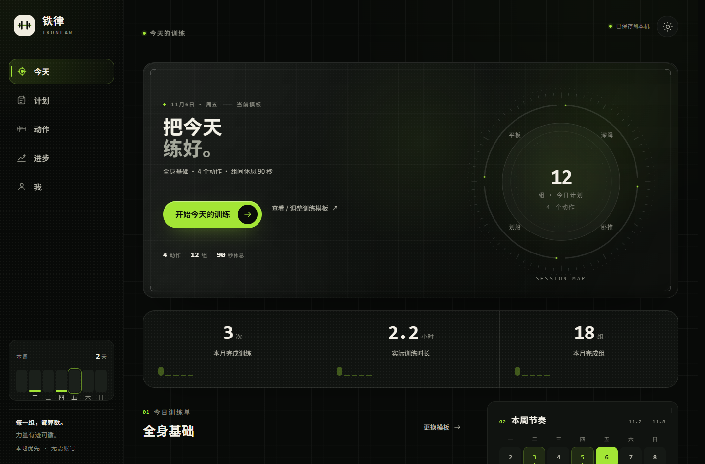
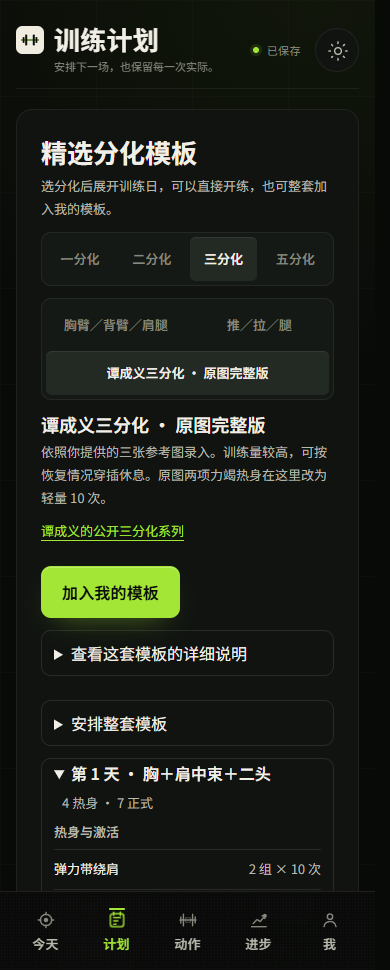
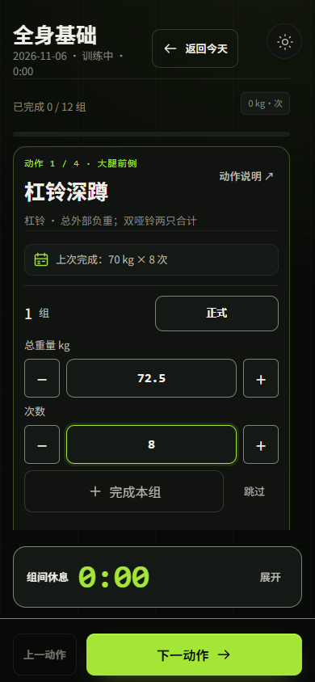

# 铁律 IRONLAW

免费的个人训练记录应用。记录每组重量、次数、时长和 RPE，回看训练容量、动作纪录和身体趋势。内置动作筛选、中文讲解与休息计时，可离线记录和导出备份。

**[立即打开网页版](https://jianlibao-training-raitox.netlify.app/mobile/)** · 手机和电脑均可直接访问。

[下载新版 Web/PWA](https://github.com/Raito666/ironlaw-training/releases/tag/v0.4.0-web.20261112) · [安卓和 iOS 上版下载](https://github.com/Raito666/ironlaw-training/releases/tag/v0.4.0-20261110) · [图文使用说明](docs/USAGE.md) · [开发与自托管](docs/DEVELOPMENT.md)

**新版手机训练流程**。已选计划一键开练，勾组自动计时，换动作保留已完成组，提前结束可直接保存实际完成的组。「今天」优先显示未完成的训练或当日排期。 [直达原图三分化完整版](https://jianlibao-training-raitox.netlify.app/mobile/#/plans?preset=photo-complete)

## 选一个版本

| 设备 | 下载项 | 使用方式 |
| --- | --- | --- |
| Windows、Mac、浏览器 | 新版 Web/PWA ZIP | 解压并启动本地 HTTP 服务。部署到 HTTPS 后可在手机上安装到主屏幕。 |
| 安卓 | 网页 PWA / 上版 Android APK | 当前新版可用 Chrome 安装到主屏幕。11 月 10 日版 APK 适用于 Android 7.0 或更新版本。 |
| iPhone / iPad | 网页 PWA / 上版 IPA | 当前新版可用 Safari 添加到主屏幕。11 月 10 日版 IPA 供开发者自行签名。 |
| Apple 芯片 Mac | 上版 iOS Simulator ZIP | 解压后用 Xcode Simulator 安装 `App.app`。 |

首次换设备前，可在原来的「我」页导出备份，再在新设备导入。新版 Web 支持 v1、v2 和含排期的 v3 备份。

## 新版手机训练

| 记组与休息 | 保存结果 |
| :---: | :---: |
|  |  |

## 其他界面

| 精选模板 | 训练排期 |
| :---: | :---: |
|  |  |

| 训练记录 | 动作讲解 | 历史与统计 | 身体数据 |
| :---: | :---: | :---: | :---: |
|  |  |  |  |

截图使用演示记录。训练历史按实际保存的组数计算，支持补记及备份迁移。动作可按身体部位、器械、难度和记录方式筛选，包含 302 个原有 SVG 图解动作及 5,632 个扩展动作的文字讲解。

## 许可与署名

项目代码使用 [AGPL-3.0-or-later](LICENSE)。SVG、wger 媒体、openGym 文字和身体部位路径按各自条款分发。公开版的扩展动作提供文字，Gym Visual 独立授权的图片和视频未收录。详见 [逐项来源及署名](src/content/ATTRIBUTION.md)。
