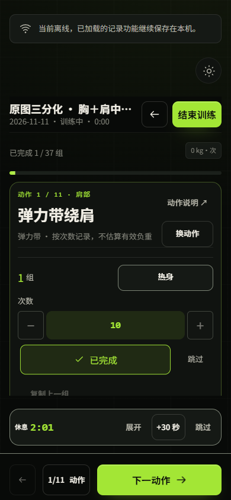
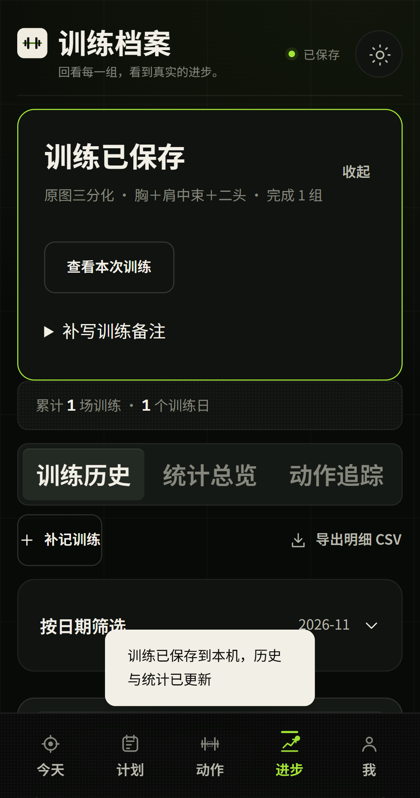
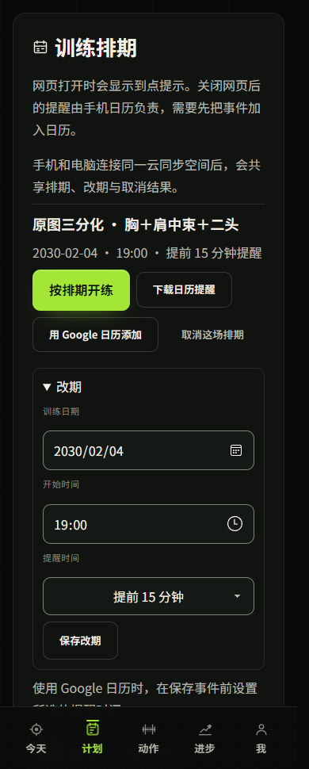
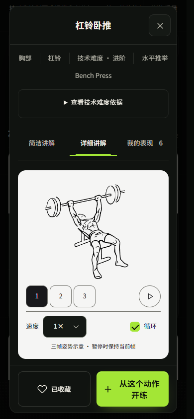
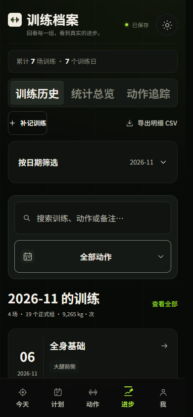
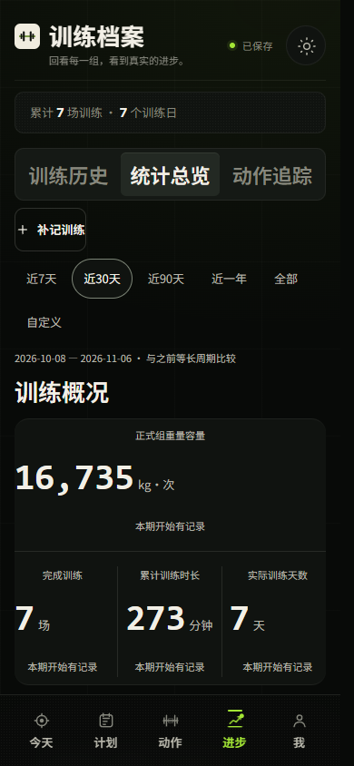
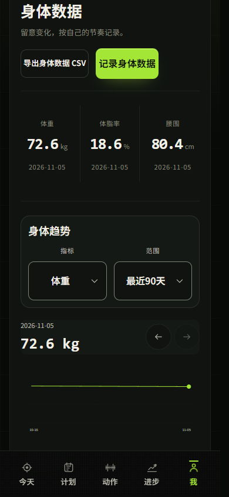

# 铁律使用说明

[打开固定网页版](https://jianlibao-training-raitox.netlify.app/mobile/) · [新版 Web/PWA 下载](https://github.com/Raito666/ironlaw-training/releases/tag/v0.4.0-web.20261112) · [11 月 10 日版安卓与 iOS 下载](https://github.com/Raito666/ironlaw-training/releases/tag/v0.4.0-20261110)。网页、手机浏览器和原生 App 各自保存本机数据，换设备前可先导出备份。

## 1. 安装或打开

- **Windows / Mac 网页版**。解压 Web/PWA ZIP，Windows 运行「启动铁律-Web.cmd」，Mac 或 Linux 在解压目录运行 `sh start-web.sh`。已安装 Python 3 时，也可运行 `python -m http.server 4173 --bind 127.0.0.1 --directory public`，在浏览器打开 `http://127.0.0.1:4173/`。
- **iPhone / iPad 网页应用**。Safari 打开部署在 HTTPS 的铁律网页，点分享菜单里的「添加到主屏幕」，再从桌面图标打开。可在「我 → 应用与离线」查看准备状态。
- **安卓手机**。下载 Android APK，用系统安装器打开，按系统提示允许当前下载来源安装。也可以用 Chrome 打开 HTTPS 站点，再选「安装应用」或「添加到主屏幕」。原生预览版要求 Android 7.0 或更高版本。
- **Mac 上的 iOS 模拟器**。Apple 芯片 Mac 安装 Xcode 和 iOS 模拟器，解压 Simulator ZIP，将 `App.app` 拖到已启动的模拟器。命令行可用 `xcrun simctl install booted App.app`。
- **iPhone 原生开发版**。Release 的 IPA 未签名，需要在自己的开发环境配置签名和设备授权。用 Xcode Personal Team 免费签名时需要定期重新部署。日常可直接用 PWA。 [Apple 官方说明](https://developer.apple.com/help/account/basics/about-your-developer-account/)

## 2. 新版 Web/PWA 如何记一次训练

1. 打开「今天」，直接开始当日排期或继续草稿。也可以在「计划」里选好当天模板，点「开始第 X 天」开练。
2. 核对重量、次数或时长，点勾记录。自动休息时可直接点「+30 秒」或「跳过」。点底部动作计数可打开清单。
3. 从当前动作点「换动作」，选一个替代。已完成组与备注留在原动作，剩余组转给替代动作。
4. 点「结束训练」。全部做完直接保存，提前结束时点「保存已完成 X 组」。保存后可以回看记录和补备注。

 

### 安排整套训练

打开「计划 → 精选分化模板」。原图三分化完整版分开显示热身、正式动作和备选动作，可直接开练或整套加入。两套循证 A／B 方案位于二分化。

1. 展开「安排整套模板」，选首周日期、时间和重复周数，最多 12 周。
2. 在「训练排期」点「改期」或「取消这场排期」。替代动作随该场训练保留。
3. 手机和电脑连接同一个加密同步空间。关闭网页后要收到提醒，请先把事件加到设备日历。改期后也请在设备日历更新已添加的事件。

## 3. 找动作和看讲解

点「动作」，可用身体正背面、器械、技术难度和记录方式筛选。打开动作卡，切换「速查」或「详细讲解」，也可收藏动作。原有动作有三帧 SVG，部分动作有可离线保存的 wger 视频。扩展目录提供步骤、动作描述和署名。

## 4. 查历史、趋势和身体记录

在「进步」中切换「训练历史」与「统计总览」。历史可打开某次训练查看各组，统计可选周期查看训练频次、容量、肌群分布和个人纪录。漏记时可在历史页选择补记。

在「我 → 身体数据」记录体重、体脂和围度，可按指标与范围查看曲线，也可导出 CSV。

| 历史 | 统计 | 身体 |
| :---: | :---: | :---: |
|  |  |  |

## 5. 备份和同步

- 在「我」里选「导出备份」，保存 JSON。换浏览器或手机时，先在新环境选择文件，检查预览再确认导入。CSV 便于查看，恢复完整记录请使用 JSON。
- 新版备份可包含排期，仍能导入 v1 和 v2 备份。连接含排期的云同步空间时，各端使用此版本或更新版本。
- 云同步需要主动连接同一个同步空间。同步密钥请私下保管，普通备份里没有密钥。原生版可以连接应用内置同步服务。自行部署的 Web 版需另外部署同步函数，本地静态 ZIP 可直接使用记录和备份。
- 草稿及离线素材各自保存在设备里。卸载应用或清理浏览器存储前，请先导出备份。

截图均为演示数据。安装包摘要随 Release 的 `SHA256SUMS.txt` 一起提供。
